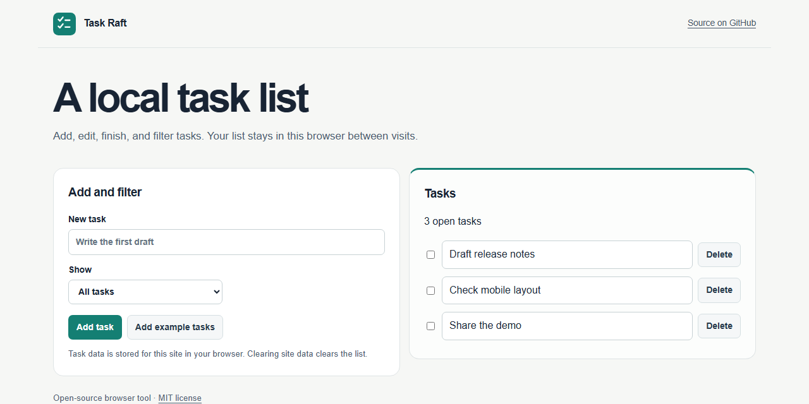

# Task Raft

**A local task list.** Add, edit, finish, and filter tasks. Your list stays in this browser between visits.

[Open the live tool](https://musabukhari237.github.io/task-raft/) · [Report an issue](https://github.com/MusaBukhari237/task-raft/issues)

[](https://musabukhari237.github.io/task-raft/)

## Try an example

Choose Add example tasks. Complete one, filter by Completed, then reload to see that the change persists.

## Usage and limits

Edit a task inline, use its checkbox to complete it, and use the filter to focus on open or completed tasks. Browser storage is scoped to the current site.

## Run locally

Clone this repository, then run:

```sh
python -m http.server 8000 --bind 127.0.0.1 --directory docs
```

Open http://127.0.0.1:8000 in a browser. The site needs no package install. Run `node --test` with Node.js 22 or newer.

## Sponsors

Supported by [LeadCeleris](https://www.leadceleris.com/) and [AIFFICIENTO](https://www.aifficiento.biz/).

## Contributing and license

Use synthetic input in bug reports and contributions. See [contribution notes](CONTRIBUTING.md) and the [MIT license](LICENSE).
